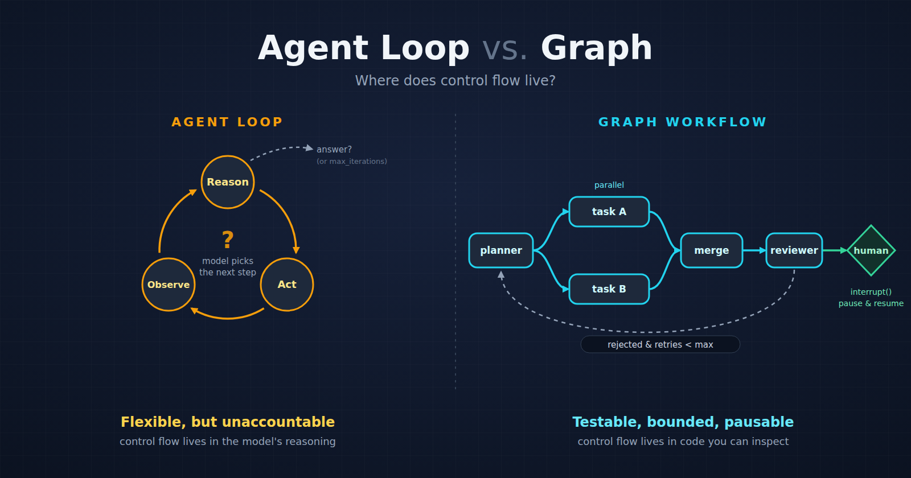

# LLM Dev Roadmap



A self-study project: learning to build LLM applications by building one thing
for eight weeks, one layer at a time. The thing is an **SRE / on-call
copilot**. You give it an incident ("payments-service is seeing cascading 429s
from our payment provider"), it searches runbooks, postmortems and vendor docs,
proposes a root cause and a fix, checks that its own answer is backed by the
evidence it found, and **pauses for a human to approve** before it does anything.

Each week adds one concept and one set of experiments to the same codebase.

> **Status:** Weeks 1–4 are done. Week 5 (RAG) is in progress. Weeks 6–8 are planned.

## Start here

- **Blog post:** [Agent Loop vs. Graph: What I Actually Gained by Rebuilding My SRE Copilot in LangGraph](https://abinjj9.hashnode.dev/agent-loop-vs-graph-rebuilding-my-sre-copilot-in-langgraph)
  covers the Week 3 → Week 4 rebuild, with code and real run output.
- **The code that runs the copilot** is in [`assistant/`](assistant/). Each
  `weekN_*/` folder holds that week's README and experiments.

## The roadmap

| Week | Topic | What I built / learned | Status |
|:---:|---|---|:---:|
| 1 | [Prompts & fundamentals](week1_prompts_and_fundamentals/README.md) | A thin OpenAI client, then experiments on temperature, streaming, structured output, context windows and prompt injection | Done |
| 2 | [Chat & tool calls](week2_basic_chat_tool-calls/README.md) | A tool registry and dispatcher, conversation state with truncation, typed events, rate-limit backoff, a FastAPI `/chat` endpoint with streaming | Done |
| 3 | [Agents](week3_agents/README.md) | A hand-rolled ReAct loop (reason → act → observe), the same agent via LangChain, and experiments that try to break it | Done |
| 4 | [Workflow orchestration](week4_workflow_orchestration/README.md) | The same copilot as an explicit LangGraph graph: parallel fan-out/fan-in, a bounded retry loop, a human-approval pause/resume, and eval checks that run on captured traces | Done |
| 5 | [RAG fundamentals](week5_rag_fundamentals/README.md) | Replacing fake fixtures with a real corpus: load → chunk → embed → store → retrieve, FAISS vs. pgvector, chunking comparisons, a golden question set | In progress |
| 6–8 | Evals, multi-agent, capstone | Planned | Planned |

## The copilot in one picture

```
planner ─┬─ search_docs ────┐
         │                  ├─ merge → synthesizer → reviewer ─┬─ approved → [human approves] → apply_fix
         └─ search_vendor ──┘            ▲                     │
              (run in parallel)          └──── rejected, ──────┘
                                         retries < max
```

- The **planner** decides what to look for. Two searches run **in parallel**
  and are merged.
- The **synthesizer** proposes a root cause and fix. The **reviewer** rejects
  anything not supported by the retrieved evidence.
- A rejection sends the run back to the planner, up to a fixed retry limit. If
  the limit is hit, the run stops instead of guessing.
- `apply_fix` is gated by a human approval. The graph is checkpointed, so it
  can pause and resume later, even in a different process. The fix itself is
  mocked for now.

The Week 3 loop and the Week 4 graph answer the same questions with the same
tools. The difference is where control flow lives: in the model's reasoning, or
in code you can test and bound. The blog post walks through this in detail.

## Repo layout

```
assistant/                    the copilot, shared by all weeks
  agent/                      loop.py (Week 3), graph.py + nodes/ (Week 4)
  ingestion/                  fetch, load, chunk, build the index (Week 5)
  tools/                      tool registry + search / apply_fix tools
  llm_client.py, embeddings.py, vectorstore.py, retrieval.py
  main.py                     FastAPI: /chat, /research, /research/resume
weekN_*/                      each week's README and experiments (+ saved results)
assets/                       images used in this README
docker-compose.yml            Postgres + pgvector for Week 5
```

## Running it

You need Python 3 and an OpenAI API key. Docker is only needed for the Week 5
pgvector experiments.

```bash
python -m venv .venv && source .venv/bin/activate
pip install -r requirements.txt

cp .env.example .env        # then put your OPENAI_API_KEY in .env
chmod 600 .env
```

Each week's README has its own setup and run steps. Experiments live in
`weekN_*/experiments/` and save their output to `experiment_results/`.

Notes:

- **Weeks 1–4** use small local fixtures. Seed the sample database with
  `python assistant/tools/seed_db.py`.
- **Week 5** retrieval runs over a real corpus (PostgreSQL, Kubernetes, NGINX,
  Kafka, Redis, Prometheus docs, public postmortems and more). That text is
  **not committed**. Re-create it with `python -m ingestion.fetch` from
  `assistant/`. See the [Week 5 README](week5_rag_fundamentals/README.md).
- **API cost:** the models used are cheap tiers (see `.env.example`), and
  embedding the whole corpus costs a few cents. Use a project-scoped key with a
  spend limit.
- **Model names** change quickly. Check `.env.example` against what your
  account can call.

## About the weekly READMEs

This is a learning repo, so the weekly READMEs read like a study plan: an order
of operations, "TODO" markers, and a "what done looks like" checklist. Each
experiment file ends with an `OBSERVATIONS` block that records what I saw and
why. The saved run outputs are in each week's `experiment_results/`.

## License

[MIT](LICENSE)
